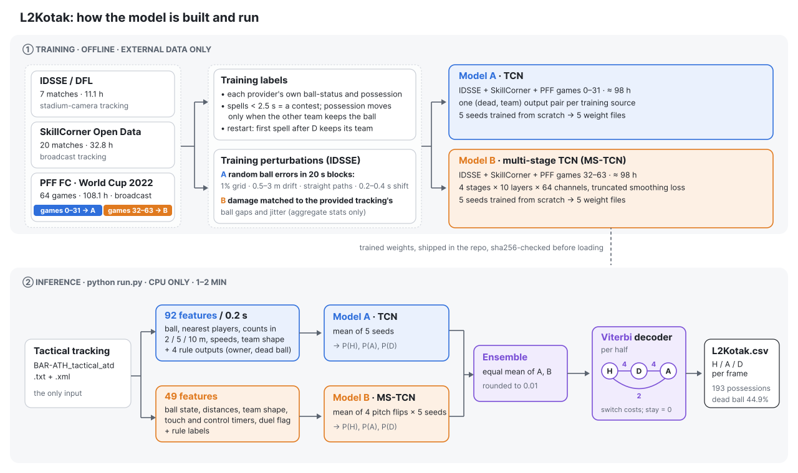
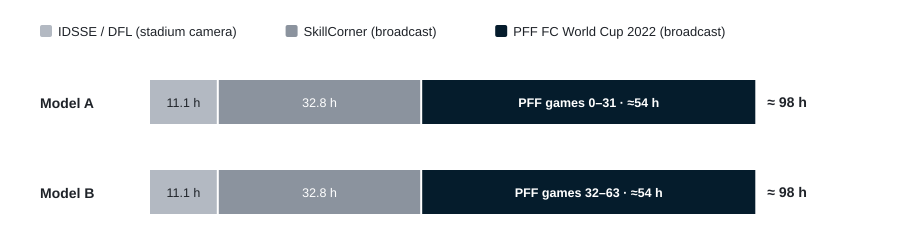
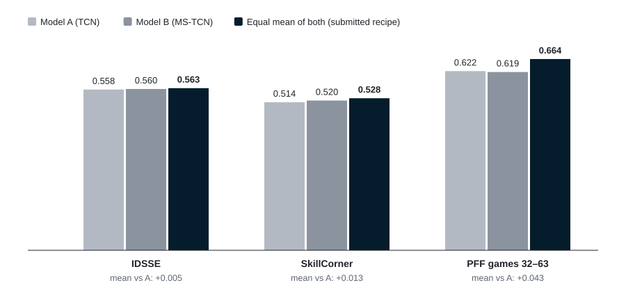
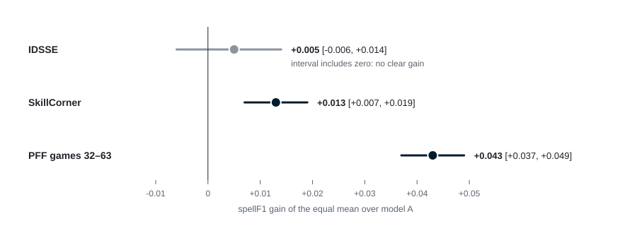
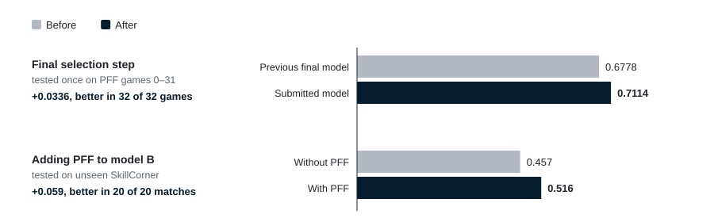

# L2Kotak

Submission for More than a Hack 2027, Initial Challenge.

**L2Kotak Members:** Maulana Raji Shofil Fuadi, Ahmad Shafwan Dzaky, Muh. Wira Ramdhani Fadhil, Muhammad Faturihsan.

Submission file `L2Kotak.csv`, sha256 `139663eefb462fc623543ac51d013d66cd72c7b2a6d50d27fd47eaaa460c9279`.\
GitHub: https://github.com/dezurzz/more-than-a-hack-2027 (its README has the same reproduction steps as section 8).

## 1. Summary

For every frame the model says whether the home team has the ball (H), the away team has it (A), or the ball is dead (D). At run time it reads the provided tracking and nothing else.

The model is an ensemble of two complementary model families: a TCN (model A) and a multi-stage TCN (model B). Each family averages five independently trained networks, and their probabilities are combined before a shared Viterbi decoder produces the final labels. Both are trained on tracking from other matches (IDSSE/DFL, SkillCorner, PFF FC). No network was trained on the provided match, and all training labels come from external data.

| Item | Detail |
|---|---|
| Inputs | `BAR-ATH_tactical_atd.txt` and `.xml` only |
| Models | A: five seeds of a TCN on 92 features. B: five seeds of a multi-stage TCN on 49 features |
| Combination | equal mean of the H / A / D probabilities, Viterbi per half |
| Output | 193 possessions, dead ball on 44.9% of graded frames |
| Runtime | one to two minutes on a laptop CPU, no GPU |



*Figure 1. Top: both models are trained only on external tracking (IDSSE, SkillCorner, PFF), each on about 98 hours with its own half of PFF. Bottom: at run time the tactical tracking is the only input; the two models' probabilities are averaged and a Viterbi pass per half turns them into possessions.*

## 2. Approach and why

**The problem as we read it.** The ground truth comes from [corrected tracking, as described by the organisers](https://github.com/metrica-sports/more-than-a-hack-2027/blob/main/CHALLENGE.md#what-is-already-settled). The tracking we are given is uncorrected: the ball is missing on 40.7% of graded frames, mostly in long gaps (median about 10 s), and players leave the camera's view. So the task is to recover possession from damaged tracking, and the hard part is the frames where the ball is not seen.

**Why a learned model.** We started with rules: the nearest player within 1 m for 10 frames owns the ball, and a weighted list of dead-ball cues (ball beyond a line, everyone walking, ball still). Rules do well while the ball is tracked and have nothing to go on when it is not. A network that sees tens of seconds of context can use what the players do while the ball is missing. The rules were not thrown away: their outputs are four of model A's inputs, and on providers the model never saw they add about 0.008 spellF1.

**Why external data.** One match, and only 17 public possessions, is too little to train or tune on. Three public or licensed tracking datasets carry a ball-status and a possession annotation of their own, so they give about 152 hours of labelled play (section 3).

**Why two networks.** The two models were built independently, with different features, architectures and label handling. Leaving one provider out of training, their equal mean was better than either alone on all three providers (section 6). A learned combiner and a third model of another family were tried and did not beat the plain mean.

**Why this decoder.** Per-frame probabilities flicker. A Viterbi pass with fixed costs for changing team (2) and for entering or leaving dead ball (4 each) gives possessions of realistic length. The costs were chosen on IDSSE leave-one-match-out folds and kept. Later tests of other costs on external data found nothing better.

## 3. Data: what was used, and what was tried and dropped

### 3.1 The provided assets

| Asset | Use |
|---|---|
| Tactical tracking (ATD) | **The only input of the final model.** Player slots, ball, and each slot's team as the tracking gives it. |
| Smart Tagging | Not read by the final model at run time. Aggregate counts of the tags (an automated competition asset) were used when setting some rule-input thresholds (section 7). A rule that made every tagged set-piece window dead ball was tried and dropped: the windows are 35 s long and mostly live play. |
| Homography | Not used. The tracking is already in pitch coordinates and the model does not read video. |
| Video (tactical, broadcast) | Not used by the final inference pipeline. Both models read the tracking only. |

Aggregate statistics of the provided tracking (how often the ball is missing, how long the gaps are, jitter, with no frames and no labels) are used in `noise_atd.json` to damage clean external tracking for model B's training, and in `atd_profile.json` for evaluation copies of IDSSE (the submitted model A weights were trained without that damage).

### 3.2 External training data

| Dataset | Play used | Annotation the labels are read from | Licence |
|---|---|---|---|
| IDSSE / DFL (Bassek et al. 2025, Scientific Data 12:195) | 7 matches, 11.1 h | ball-status and possession flags of the DFL's official position data | CC BY 4.0 |
| SkillCorner Open Data (A-League 2024/25) | 20 matches, 32.8 h | SkillCorner's phases of play (team in possession while the ball is in play) | MIT |
| PFF FC, FIFA World Cup 2022 | 64 games, 108.1 h | PFF's game events (kickoff, player has control, ball out, stoppages) | PFF FC's public release, obtained by registration under its terms and not redistributed |

Model A is trained on IDSSE, SkillCorner and PFF games 0-31, and model B on IDSSE, SkillCorner and PFF games 32-63. This allocation emerged during development and follows ascending game ID, not a random assignment; overlap in teams or tournament phases was not audited. Each sees about 98 hours. IDSSE is stadium-camera tracking, while SkillCorner and PFF are broadcast tracking, closer to the provided one. No label was made or corrected by hand by the team.



### 3.3 Tried and not adopted

The following alternatives were tested on a provider the model had never seen and did not improve on the final model:

- **Input features and preprocessing:** touch features without thresholds, a smoothed ball track, and whole-match input standardisation.
- **Model architecture and combination:** a transformer as a third model, a boundary head with hard cuts at its peaks, and a learned combiner in place of the equal mean.
- **Training and label handling:** damaging half of the PFF games and a per-source label-noise layer.
- **Post-processing:** a minimum possession length after decoding.
- **Additional training data:** Metrica open data as a fourth source, which improved results on IDSSE but worsened them on SkillCorner.

A candidate with all 64 PFF games in model B scored higher on development data but could not be tested on untouched data, so it was not adopted.

## 4. Possession rules implemented

The model is learned, so its rules live in three places: the training labels, the rule inputs, and the decoder.

**Touches, challenges and loose balls (training labels).** The providers flag possession at every touch, but the challenge counts controlled possession. In the labels a run of possession spells that are each shorter than 2.5 s is treated as a contest:

- if the same team has the ball before and after it, or the ball goes dead after it, the whole contest stays with the team before (a touch, a deflection, an aerial duel without control).
- if the other team keeps the ball after it, possession changes at that team's first touch in the contest.
- a loose ball therefore stays with the last team until someone else controls it.

The threshold is T = 2.5 s. On external data, the possession rates in SkillCorner's and PFF's own annotations support thresholds of 1.5, 2.0 and 2.5 s for IDSSE. Shorter and longer ones fall outside that range.

**Dead ball.** D is the provider's own ball-status: IDSSE's flag, the gaps between SkillCorner's phases of play, PFF's out-of-play and stoppage events (substitution, player off or on, video review). The model learns to call D from the picture those leave in the tracking: ball beyond a line, ball vanished heading out, players walking, ball placed and still.

**Restarts.** A restart has a clear possessor: in the labels the first spell after a dead ball keeps its team even when it is short.

**Rule inputs of model A.** The owner is the last player who stayed nearest to the ball within 1 m for 10 consecutive frames. The dead-ball rule is a logistic score with weights for: ball beyond a line by 0.5 m, ball vanished heading out of the pitch, everyone slow, ball still, ball lost while play is slow, kickoff formation. The dead-ball score enters the network as its rank within the match, so that its scale does not depend on the provider.

**Match structure.** Frames outside the two halves are X. The frames between the start of the second-half recording and its kickoff (110808-113742) are D, and both models start the second half at the kickoff.

## 5. The model

**Model A (TCN).**

- **Input:** 92 features per 0.2 s step. Ball position, speed and how long it has been unseen, then for each team the nearest distances to the ball, counts of players within 2, 5 and 10 m, speeds, spread and centroid. The same again at the previous and next ball observation, means over 1, 4 and 12 s, and the four rule outputs. Where the ball is missing, distances use an estimated ball and the network is told how old the estimate is. Positions are in the home team's attacking frame, so a feature means the same in both halves. The feature list follows one published by Wira, and using the rule outputs as inputs was Dzaky's idea.
- **Network:** a TCN with one (dead, team) output pair per training source, five seeds averaged.
- **Training perturbations:** training copies of IDSSE carry random ball perturbations (rounding, drift, interpolation, small time shifts) taken from Wira's recipe: in 20 s blocks, each changed with probability 0.5, by a 1% pitch grid, a ball drift of 0.5-3 m, straight-line ball paths between knots 1-3 s apart, or a shift of 0.2-0.4 s.

**Model B (MS-TCN).**

- **Input:** 49 features (ball state, distances and counts per team, team shape and speed, rule labels, touch and control timers, a duel indicator).
- **Network:** a multi-stage TCN (4 stages, 10 layers, 64 channels) after Farha and Gall (2019), with the truncated smoothing loss. Predictions are averaged over the four flips of the pitch, and five seeds are averaged.
- **Training perturbations:** its IDSSE copies are damaged to resemble the provided tracking.

**Combination.** Equal mean of the two models' probabilities per frame, rounded to 0.01 per 0.2 s step, then Viterbi per half with costs 2 (change of team), 4 (into dead ball), 4 (out of dead ball).

## 6. Evidence

All scores are spellF1 on external data with the decoder above. Intervals are 95% percentile confidence intervals for the mean spellF1 difference, estimated using 2,000 paired bootstrap resamples over matches with random seed 0.

### 6.1 A provider the model never saw

Each recipe is trained without one provider and scored on it.



| Recipe | IDSSE | SkillCorner | PFF 32-63 |
|---|---|---|---|
| Model A's recipe | 0.558 | 0.514 | 0.622 |
| Model B's recipe | 0.560 | 0.520 | 0.619 |
| Equal mean of both | 0.563 | 0.528 | 0.664 |

The mean against model A: +0.005 [-0.006, +0.014], +0.013 [+0.007, +0.019], +0.043 [+0.037, +0.049]. These are scores of the recipe. The submitted weights were trained on all three providers and have no unseen-provider score of their own.



Adding PFF to model B's training raised its score on unseen SkillCorner from 0.457 to 0.516 (+0.059 [+0.051, +0.067], 20 of 20 matches).

### 6.2 How the final model was selected

Candidates were compared by leaving one provider out of training. The last step, from the previous final model to the one submitted, was tested once on PFF games 0-31, with a gate written beforehand: 0.7114 against 0.6778, +0.0336 [+0.0285, +0.0387], better in 32 of 32 games. For this test, model B used games 32-63 and model A was retrained without PFF; the submitted model A has since seen games 0-31. This is a game-level hold-out within the same provider and tournament, not a test on a new domain.



A later model B trained on all 64 PFF games improved over its 32-game version on unseen IDSSE (+0.0469) and SkillCorner (+0.0147). However, games 32-63 had already been used for development and games 0-31 had been used once for selection, so no untouched PFF games remained for an independent test. An earlier 64-vs-32 comparison in model A's architecture was slightly worse on IDSSE and SkillCorner; the architecture and protocol differed, and the reason for the different result was not investigated. The 64-game candidate was therefore not adopted.

## 7. Limitations and next steps

Each item below says what is not known, why it was left open, and what we would do next.

**Where we are least certain**

- **Broadcast-type tracking.** SkillCorner is the hardest provider (about 0.53 spellF1 against 0.56 to 0.66 on the others), and the provided tracking is of that kind. On it the model still splits possessions too often. We chose to train on three providers rather than tune for one, because one match is too little to tune on. Next: more broadcast-type training data that has a ball-status annotation.
- **Long ball gaps.** The ball is missing for tens of seconds at a time. The model uses what the players do during the gap, but we cannot measure its accuracy inside the gaps on the provided match, because the only labels for it are the 5 public minutes.
- **Dead ball with the ball still on the pitch.** The model learns dead ball from the cues stoppages leave in the tracking (ball beyond a line, players walking, ball still). No external source annotates stoppages inside the pitch in a form we could test against, so we did not build a dedicated model for them. Next: a dead-ball model for this case.

**What the evidence does and does not cover**

- **The submitted weights have no score of their own on unseen data.** They were trained on all three providers, so none is left to test on. The nearest evidence is section 6.1, which scores the same recipes with one provider left out.
- **Fixed settings.** The decoder costs and T = 2.5 s were fixed early on external data, and later tests found nothing better. They were not re-chosen for the final model.
- **Hand-set parameters.** Four of model A's 92 inputs, and the rule labels of model B, come from rules whose parameters are domain priors, not fitted values (owner radius 1 m, 10 confirming frames, zone radii, dead-ball weights). Some of these thresholds were set by judgement and from aggregate counts of the provided tracking and of the Smart Tagging tags. We kept them because the columns themselves help on unseen providers (+0.008 spellF1 for model A). The sizes of the ball perturbations in training are likewise assumptions about tracking error. Next: re-derive these parameters on external data.

**Reproducibility.** The output hash was reproduced on two Windows 11 laptops, in a fresh environment, and on macOS 15.7 (Apple M4). It was not checked on Linux. GPU training is not bit-reproducible, so the repository ships the weights used and the run itself is CPU-only.

**With more time**, in this order: a dead-ball model for stoppages inside the pitch, more broadcast-type training data, Wira's network retrained on all three providers as a third model, and the all-64-PFF-games candidate for model B once there is untouched data to test it on.

## 8. Reproduction

```powershell
py -3.12 -m venv .venv                 # macOS / Linux: python3.12 -m venv .venv
.venv\Scripts\activate                  # macOS / Linux: source .venv/bin/activate
pip install -r requirements-mtah.txt
python run.py --no-log
```

Python 3.12.10, numpy 2.5.2, torch 2.8.0 (CPU). Unpack the competition bundle into `data/` (or set `MTAH_DATA_DIR`). Only the two tactical ATD files are read. The command writes `outputs/L2Kotak.csv`, validates it with the organisers' checker and prints the sha256 above, 193 possessions, dead share 44.9%, and H 0 / A 0 / D 2934 for frames 110808-113742. All weights are in the repository and their sha256 is checked before loading. `python -m pytest tests` runs the checks of the final build. Training and evaluation code is included for inspection (README, "Training code").

## 9. Disclosures

- **Team contributions:** Maulana Raji Shofil Fuadi: pipeline, model A, combination and evaluation. Ahmad Shafwan Dzaky: model B, its architecture, features and training code. Muh. Wira Ramdhani Fadhil: the feature list model A follows, the ball perturbations in its training, and a third model tried in earlier versions. Muhammad Faturihsan: approach notes and a dead-ball rule that was tested and not adopted.
- **External data and licences:** section 3.2, with full notes in `NOTICE.md` of the repository.
- **Third-party code:** the organisers' starter kit (MIT). Model B's network follows MS-TCN (Farha and Gall, CVPR 2019) and is close in structure to the authors' implementation (MIT with Commons Clause, licence text shipped). Its boundary branch follows Ishikawa et al. (WACV 2021) and is not used by the final model.
- **Rule cues of model B:** model B's rule-label inputs come from a rule pipeline whose settings (`mtah/members/dzaky11/config.py`) are tagged in Indonesian. `[ASLI]` ("original") marks cues taken from Vidal-Codina et al. (2022): smoothing of the ball track, control and duel zones around players and the ball, touches detected by a change of the ball's direction or speed, and restart triggers (corner flag, centre spot, kickoff layout). The zone radii were widened from the paper's 0.5-1 m to 1.5 m for single-camera tracking. `[ADAPTASI]` ("adapted") marks what the team added for this data: interpolation of short ball gaps, the rule that only a controlled touch changes possession, the dead-ball cues, the labels and the tidying of short spells.
- **Pre-trained models:** none. Every network was trained by a team member from scratch.
- **AI assistance:** an AI coding assistant wrote code, tests and documentation. It was never given the competition data.

## 10. References

**Methods**

1. Farha, Y. A., and Gall, J. (2019). MS-TCN: Multi-Stage Temporal Convolutional Network for Action Segmentation. *CVPR 2019*. Code: https://github.com/yabufarha/ms-tcn. Model B's network and loss.
2. Lea, C., Flynn, M. D., Vidal, R., Reiter, A., and Hager, G. D. (2017). Temporal Convolutional Networks for Action Segmentation and Detection. *CVPR 2017*. The TCN family of both models.
3. Ishikawa, Y., Kasai, S., Aoki, Y., and Kataoka, H. (2021). Alleviating Over-segmentation Errors by Detecting Action Boundaries. *WACV 2021*, arXiv:2007.06866. Model B's boundary branch, not used by the final model.
4. Vidal-Codina, F., Evans, N., El Fakir, B., and Billingham, J. (2022). Automatic event detection in football using tracking data. *Sports Engineering* 25. The `[ASLI]` rule cues of model B.
5. Viterbi, A. (1967). Error bounds for convolutional codes and an asymptotically optimum decoding algorithm. *IEEE Transactions on Information Theory* 13(2), 260-269. The decoder.
6. Efron, B. (1979). Bootstrap methods: another look at the jackknife. *The Annals of Statistics* 7(1), 1-26. The paired bootstrap intervals in section 6.

**Data**

7. Bassek, M., Rein, R., Weber, H., and Memmert, D. (2025). An integrated dataset of spatiotemporal and event data in elite soccer. *Scientific Data* 12, 195. doi:10.1038/s41597-025-04505-y. Data: figshare doi:10.6084/m9.figshare.28196177 (CC BY 4.0, data owner DFL).
8. SkillCorner. SkillCorner Open Data, A-League 2024/25. https://github.com/SkillCorner/opendata (MIT).
9. PFF FC. FIFA World Cup 2022 event and tracking data. https://www.blog.fc.pff.com/blog/pff-fc-release-2022-world-cup-data (PFF FC Terms of Use).

**Competition**

10. Metrica Sports and Barça Innovation Hub (2026). More than a Hack 2027: Frame-level Ball Possession, v1.0.0. https://github.com/metrica-sports/more-than-a-hack-2027 (MIT).
